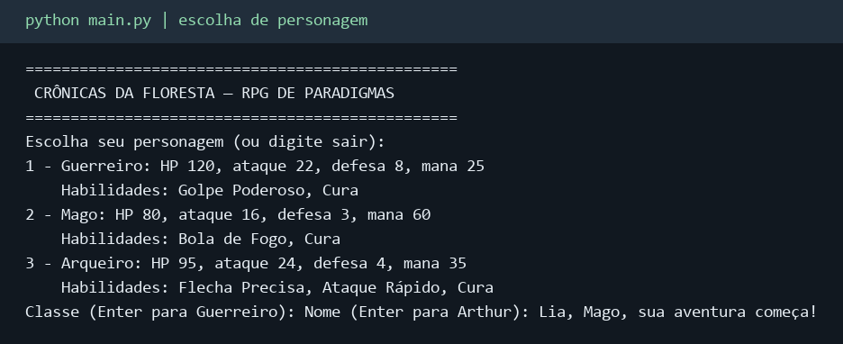
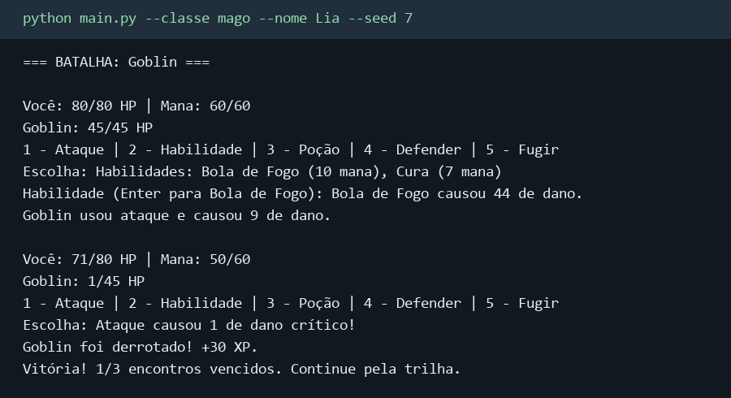
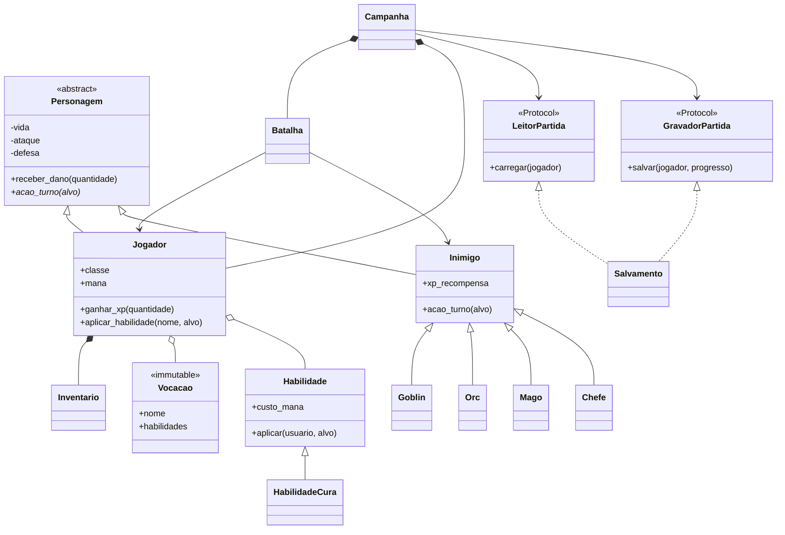

# Crônicas da Floresta

RPG em **console**, desenvolvido em Python para o trabalho de Paradigmas de Programação: **POO e os cinco princípios SOLID**. Escolha Guerreiro, Mago ou Arqueiro, explore a floresta, organize o inventário e vença três encontros para enfrentar o Rei Goblin.

## Executar no console

Requer **Python 3.10 ou superior**. O console usa somente a biblioteca padrão: não precisa instalar dependências nem compilar.

```sh
git clone https://github.com/nuneco31/RPG---PARADIGMAS-POO.git
cd RPG---PARADIGMAS-POO
python main.py
```

Na abertura, escolha a classe e o nome. Use os números dos menus para jogar. Para iniciar diretamente com um personagem e repetir os sorteios de uma demonstração:

```sh
python main.py --classe mago --nome Lia --seed 7
```

`--terminal` continua disponível como opção explícita. `--save minha-partida.json` escolhe outro arquivo de salvamento. `python main.py --help` lista as opções. Em sistemas que usam o nome `python3`, substitua `python` nos comandos.

## Personagens e regras

| Classe | Vida | Ataque | Defesa | Mana | Esquiva | Habilidades |
| --- | ---: | ---: | ---: | ---: | ---: | --- |
| Guerreiro | 120 | 22 | 8 | 25 | 5% | Golpe Poderoso, Cura |
| Mago | 80 | 16 | 3 | 60 | 8% | Bola de Fogo, Cura de 40 HP |
| Arqueiro | 95 | 24 | 4 | 35 | 20% | Flecha Precisa, Ataque Rápido, Cura |

Os tipos de jogador são modelados por **composição**: `Jogador` possui uma `Vocacao` imutável e habilidades. Isso evita subclasses que apenas repetiriam métodos com números diferentes. A herança aparece em `Personagem`, nos inimigos e nas habilidades.

- **Exploração:** estrada e floresta oferecem inimigos, tesouros, armadilhas e uma curandeira. A floresta tem mais encontros hostis.
- **Combate por turnos:** ataque, habilidade, poção, defesa ou fuga. Ação inválida ou sem mana não consome o turno. O inimigo sobrevivente responde à ação válida.
- **Inventário:** poções de vida e mana, espada e escudo. Digite o nome do item para usar ou `E` para equipar.
- **Progressão:** derrotar inimigos concede XP. Subir de nível aumenta atributos e recupera vida e mana. Três vitórias comuns liberam o chefe; fugir ou perder não conta como vitória.
- **Derrota:** o personagem volta em segurança com metade da vida. Derrotar o Rei Goblin conclui a missão, e a exploração continua disponível.
- **Persistência:** salve e carregue fora do combate. O JSON guarda classe, atributos, inventário, equipamento e progresso. Arquivos antigos sem classe usam o perfil compatível `Aventureiro`.

O salvamento padrão fica em `save.json` ao lado de `main.py`, mesmo quando o programa é iniciado de outra pasta. Uma batalha em andamento não é persistida.

## Execução no console

As imagens mostram **saída real do programa registrada e renderizada em PNG**. Os textos completos estão em [início](docs/imagens/console-inicio.txt) e [combate](docs/imagens/console-combate.txt); não são resultados de batalha escritos à mão nem capturas de uma janela do sistema.





Para reproduzir o combate, execute `python main.py --classe mago --nome Lia --seed 7` e escolha: `1` (explorar), `2` (floresta), `2` (habilidade), `Enter` (Bola de Fogo), `1` (ataque) e `7` (sair). A mesma semente depende também das mesmas escolhas. Com a dependência gráfica instalada, `python scripts/registrar_console.py` atualiza os registros e imagens.

## POO no código

| Conceito | Onde aparece |
| --- | --- |
| Abstração | `Personagem(ABC)` define o contrato abstrato `acao_turno`. |
| Encapsulamento | Propriedades limitam vida e mana; `Inventario` retorna cópias de seus dicionários. |
| Herança | `Jogador` e `Inimigo` herdam de `Personagem`; os inimigos especializam `Inimigo`; `HabilidadeCura` especializa `Habilidade`. |
| Polimorfismo | `Batalha` chama `inimigo.acao_turno(jogador)`; `Jogador` chama `habilidade.aplicar(...)`. O objeto concreto define o comportamento. |
| Composição | `Jogador` possui `Inventario` e `Vocacao`; a apresentação possui `Campanha`. |

## Os cinco princípios SOLID

### S — Single Responsibility: responsabilidade única

As classes têm motivos distintos para mudar. [Batalha](jogo/batalha.py) resolve turnos; [JogoTerminal](jogo/terminal.py) lê e apresenta texto; [Salvamento](jogo/salvamento.py) trata JSON, validação e gravação atômica. Alterar a aparência de um menu não exige alterar o cálculo de dano. [Inventario](personagens/inventario.py) concentra quantidades e equipamentos; [Jogador](personagens/jogador.py) concentra progressão, mana e uso de habilidades.

### O — Open/Closed: aberto para extensão, fechado para modificação

Uma habilidade nova pode implementar `Habilidade.aplicar` e ser adicionada ao conjunto do jogador sem editar `Batalha`. O motor consulta `jogador.habilidades`, em vez de um catálogo global de golpes permitidos. Chance de crítico e fator de ataque são dados, sem decisões baseadas no nome do golpe. [HabilidadeCura](personagens/habilidade.py) substitui o efeito de dano por cura.

O teste `test_habilidade_nova_e_aceita_sem_alterar_motor` acrescenta um Dreno que causa dano e cura o usuário, demonstrando a extensão durante um combate. Para disponibilizar uma classe nova no menu, ainda é necessário registrá-la em `VOCACOES` e `CLASSES_JOGAVEIS`: o ponto de configuração permanece explícito.

### L — Liskov Substitution: substituição de Liskov

Goblin, Orc, Mago e Chefe atendem ao contrato de `Personagem.acao_turno(alvo)`: aplicam uma ação e retornam o dano real, sem vida negativa. A batalha usa todos pela mesma chamada. A Rajada Arcana do Mago e o golpe periódico do Chefe alteram o comportamento sem exigir métodos especiais do chamador.

`HabilidadeCura` também preserva a assinatura e o significado do retorno de `Habilidade.aplicar`: quantidade efetivamente alterada ou `None` para recusa. Os testes verificam as pós-condições de dano e vida para todos os tipos de inimigo.

### I — Interface Segregation: segregação de interfaces

[LeitorPartida e GravadorPartida](jogo/contratos.py) são dois protocolos pequenos: um exige somente `carregar`, o outro somente `salvar`. A campanha recebe cada capacidade separadamente; um adaptador somente de leitura não precisa implementar gravação com um método que lança “não suportado”.

O teste `test_leitor_e_gravador_independentes_sem_arquivo` injeta dois objetos distintos: um só lê e outro só grava. Os protocolos são estruturais de Python (`typing.Protocol`); não exigem herança nominal nem validam tipos automaticamente em tempo de execução.

### D — Dependency Inversion: inversão de dependência

[Campanha](jogo/campanha.py), que contém o fluxo da aventura, depende dos contratos `LeitorPartida` e `GravadorPartida`. Ela não importa `Salvamento`, não escolhe caminhos e não instancia o adaptador JSON. [criar_campanha](jogo/montagem.py) é o ponto de composição: cria `Salvamento` e o fornece ao núcleo.

Assim, o fluxo de salvar/carregar pode ser testado com adaptadores em memória, sem abrir arquivos. `Salvamento` satisfaz os dois contratos estruturais. Terminal e interface gráfica usam o mesmo ponto de composição.

## Diagrama de classes

Visão do núcleo em UML, renderizada pelo GitHub com Mermaid. Setas tracejadas com triângulo indicam implementação estrutural de protocolos; o losango indica uma relação “possui”. A [versão detalhada](docs/DIAGRAMA_CLASSES.md) inclui as interfaces e seus adaptadores. Guerreiro, Mago e Arqueiro são configurações de `Vocacao`, não subclasses Python.



## Organização

```text
main.py                    Entrada CLI; console padrão e gráfico opcional
personagens/               Personagem, Jogador, inimigos, vocações, habilidades e inventário
jogo/campanha.py            Fluxo e progresso da aventura
jogo/batalha.py             Motor de turnos sem entrada/saída
jogo/batalha_terminal.py    Adaptador do combate para texto
jogo/terminal.py            Menus e criação de personagem
jogo/contratos.py           Protocolos de leitura e gravação
jogo/montagem.py            Composição e injeção dos adaptadores
jogo/salvamento.py          Persistência JSON validada
jogo/interface*.py         Interface gráfica opcional
graficos/                  Desenho da interface gráfica
tests/                     Testes de regras, contratos, persistência e interfaces
docs/                      UML, arquitetura, roteiro e registros de execução
```

Leia a [arquitetura](docs/ARQUITETURA.md) e o [roteiro de apresentação](docs/APRESENTACAO.md). Os módulos antigos `jogo/jogo.py`, `jogo/combate.py`, `jogo/eventos.py` e `graficos/renderizador.py` são do protótipo; a entrada atual usa `Campanha` e `Batalha`.

## Interface gráfica opcional

```powershell
python -m venv .venv
.\.venv\Scripts\python.exe -m pip install -r requirements.txt
.\.venv\Scripts\python.exe main.py --grafico --classe arqueiro
```

Em Linux/macOS, use `.venv/bin/python`. A janela oferece exploração, inventário, combate e Caderno POO. A classe é escolhida por `--classe` (Guerreiro por padrão no modo gráfico). Durante o combate, a navegação lateral fica bloqueada; `Esc` fecha a seleção de habilidade ou continua após o resultado.


## Testar

Sem dependências externas, execute os testes novos de classes/SOLID, campanha, persistência e CLI:

```sh
python -m unittest discover -s tests -p test_solid_e_classes.py -v
python -m unittest discover -s tests -p test_campanha.py -v
python -m unittest discover -s tests -p test_persistencia.py -v
python -m unittest discover -s tests -p test_entrada.py -v
```

Para a suíte completa, instale `requirements.txt` e execute:

```sh
python -m unittest discover -s tests -v
```

Os testes gráficos usam drivers SDL `dummy`. A suíte cobre dano, progressão, habilidades, extensão do motor, contratos de persistência, classes nos salvamentos, compatibilidade com partidas antigas, transições e cliques. O teste da entrada padrão executa Python com `-S`, comprovando que o console não depende dos pacotes gráficos instalados.
