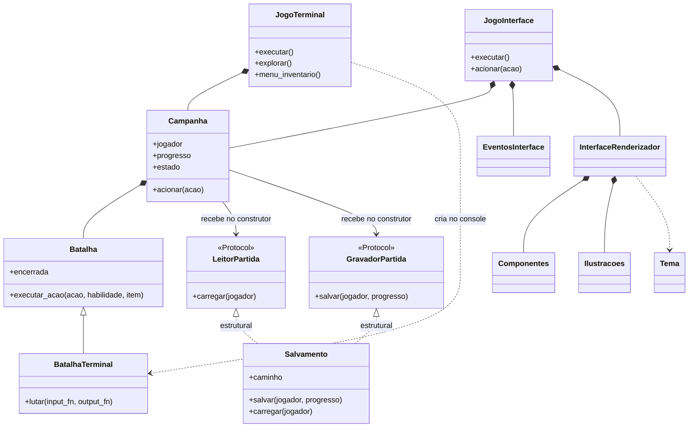
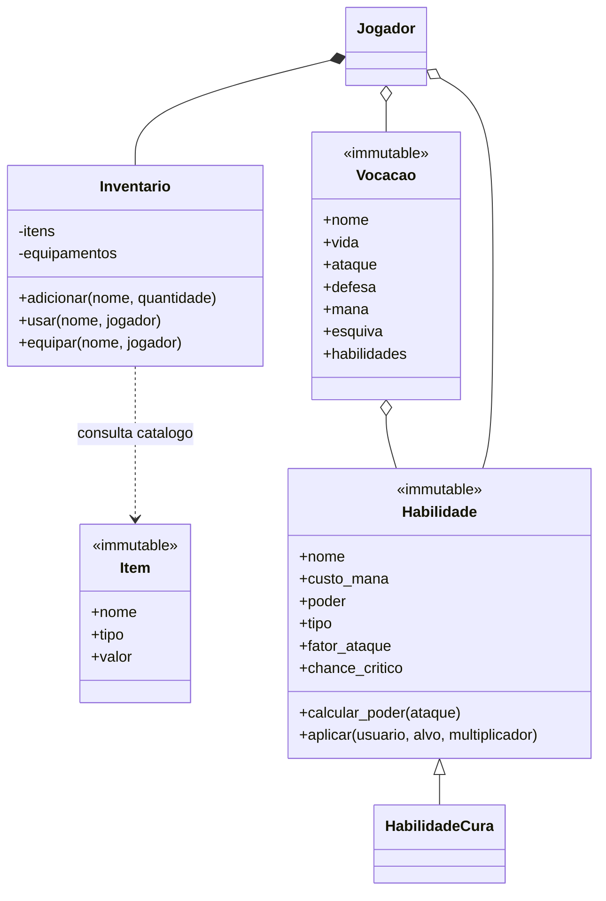

# Diagrama de classes

O [diagrama do núcleo no README](../README.md#diagrama-de-classes) mostra personagens, habilidades, inventário, batalha e contratos de persistência. Esta visão complementar mostra a composição e a apresentação que usam esse núcleo.

`BatalhaTerminal` é o nome usado no diagrama para distinguir `jogo.batalha_terminal.Batalha` de `jogo.batalha.Batalha`. No código, ambas se chamam `Batalha`; a primeira importa a segunda como `RegrasBatalha` e acrescenta a interação textual.

`criar_campanha`, em `jogo/montagem.py`, é uma função, portanto não aparece como classe. Ela instancia `Salvamento` e injeta a mesma instância nas portas de leitura e gravação. Nos testes, essas portas também recebem objetos diferentes.

## Inventário e configurações

`Inventario` guarda nomes e quantidades, consultando o catálogo de `Item`; não possui uma instância mutável por unidade. As configurações Guerreiro, Mago e Arqueiro são objetos `Vocacao` compartilhados e imutáveis. A composição aqui representa a relação de domínio “tem um”; a agregação com losango vazio destaca os objetos compartilhados.

Os módulos de protótipo preservados por compatibilidade não fazem parte do fluxo atual e foram omitidos. As relações representam o programa iniciado por `main.py`.
